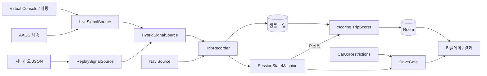
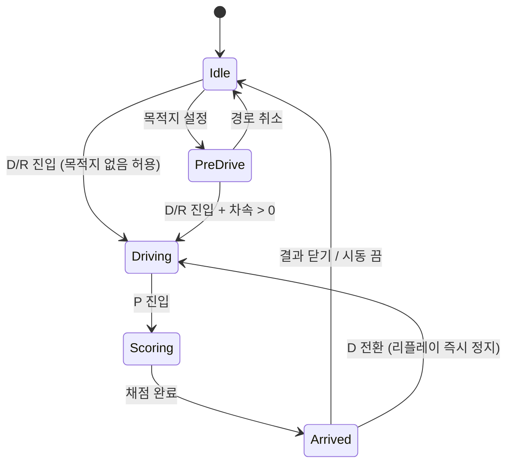

# IVECORE 설계

상태: 초안, 2026-11-01. 기능 기준은 `SPEC.md`, 일정은 `TASKS.md`, SDK 근거는 `pleos-sdk-setup.md`.
수치는 모두 초기값이며 실측 전이다. 구현 코드는 포함하지 않는다.

## 1. 명세와 충돌하는 사실, 그리고 결정

실제 SDK를 확인하니 명세의 전제 일부가 성립하지 않았다. 아래 결정을 반영하려면 SPEC·TASKS·REPLAY_FORMAT·CLAUDE.md도 고쳐야 한다(10절).

| # | 발견 | 영향 | 결정 |
|---|---|---|---|
| D1 | 공개 브레이크 API는 `Boolean`이다. 페달 % 없음 | "브레이크 0→100% 0.3초" 판정과 브레이크 그래프를 실차에서 만들 수 없음 | 급정지는 **감속도(차속 변화율)** 로 판정하고, 페달 ON은 보조 근거로만 쓴다. 오버레이는 ON/OFF 띠 + 감속도 그래프. `brakePct`는 시나리오 입력 호환용으로만 읽어 `> 0`을 ON으로 변환 |
| D2 | (콘솔 가속 페달로 라이브 차속도 가능함을 실측했으나, 재현성 때문에 시연은 하이브리드 유지) 하이브리드 모드에서 차속은 시나리오 값이라 브레이크를 밟아도 줄지 않음 | 시연 6단계가 그대로는 감점되지 않음 | 시나리오에 **급감속 구간을 미리 넣고**, 시연자는 그 시점에 브레이크를 밟는다 |
| D3 | TBT·카메라·주의 지점에 좌표가 없고 남은 거리만 있음. 경로 좌표선 API 미발견 | `NaviPoint(lat, lng)`와 "±50m" 매칭, 코스 비교가 실차에서 불가능 | 모든 판정을 **주행 누적거리(`odoM`) 축**으로 한다(4절). 좌표는 지나간 궤적 표시에만 사용 |
| D4 | SDK에 `Gear` 도메인이 있음(`CAR_DRIVE`) | CLAUDE.md는 기어를 AAOS로 받도록 함 | 기어는 **Vehicle SDK**로 받는다. 조향·브레이크와 권한이 같아 AAOS `CAR_POWERTRAIN`을 추가로 선언하지 않아도 된다. AAOS는 차속만 |
| D5 | `Vehicle:2.3.1`이 저장소에 없음 | 빌드 실패 | `2.3.2` 사용 |
| D6 | SDK 깜빡이 값은 `OFF/LEFT/RIGHT`뿐, `HAZARD` 없음 | 시나리오 형식과 불일치 | 내부 enum에서 `HAZARD`를 제거. 시나리오에 있으면 `OFF`로 읽음 |
| D7 | "±15° 1.5초"와 차선변경(10~45°, 부호 반전 후 복귀)의 조건이 겹침 | 완료 기준 1번과 3번이 분류기에서 충돌 | 차선변경은 **지속 2~8초, 부호 반전 1회 이하**. 그보다 짧거나 반전이 잦으면 흔들림(3.2) |
| D8 | 시연 시작 등급은 초보인데 초보 허용치가 ±15°이고 판정은 "초과" | 시연 4단계 ±15°가 감점되지 않음 | 시연 프로필을 **숙련 등급으로 시드**한다. 시연 시 초보 기준이 아님을 기획서에 명시 |
| D9 | 주행 중 화면 금지인데 `scriptedEvents`는 디버그 오버레이 | 안전 원칙 위반으로 보일 수 있고 영상에 찍힘 | 큐는 화면에 띄우지 않고 **logcat(`DemoCue` 태그)** 으로 출력, 시연자가 별도 창에서 본다 |
| D10 | 에뮬레이터 UX 제한 상태는 실제 VHAL 차속 기준일 가능성이 높음(재생 차속은 시스템이 모름, 미확인) | `CarUxRestrictions`만 믿으면 하이브리드에서 주행 중 UI가 열림 | 차단 조건은 **`기어 != P` 또는 `requiresDistractionOptimization`** |
| D11 | 주행 중에는 앱이 전경이 아닐 수 있음 | 백그라운드 기록과 P 진입 시 화면 자동 실행이 OS 제약을 받음 | 기록은 **포그라운드 서비스**. P 진입 시 전경이면 바로 전환, 백그라운드면 음성 + 알림으로 유도 |
| D12 | TTS/STT 기본 모드는 서버 우선 | "외부 전송 없음", 오프라인 원칙과 충돌 | **`ON_DEVICE`** 로 고정, 실패 시 Android 기본 구현. Client Secret을 앱에 넣지 않음 |

## 2. 모듈 구조

```
:scoring (순수 Kotlin/JVM, Android 의존 없음)
  model      SignalSample, RouteMarker, Maneuver, Penalty, TripResult
  config     ScoringConfig, GradeRules
  classify   ManeuverClassifier
  score      TripScorer, GradeEngine
  match      CourseMatcher, IntentMatcher

:app (AAOS)
  data/signal  VehicleSignalSource ← Replay / Live / Hybrid
  data/navi    NaviSource ← Pleos / Replay
  data/voice   VoiceOutput, VoiceInput ← Pleos(ON_DEVICE) / Android
  data/db      Room + 원시 샘플 파일
  domain       SessionStateMachine, TripRecorder, DriveGate, VoiceDirector
  service      RecordingService (포그라운드)
  ui           briefing / driving-cover / replay / result / archive / settings
```

의존 방향은 `ui → domain → (data 인터페이스, :scoring)` 한 방향이다. SDK 타입은 `data/*` 어댑터 밖으로 나가지 않는다.



## 3. 채점 엔진 `:scoring`

### 3.1 데이터 모델

```kotlin
data class SignalSample(
    val t: Double,                 // 주행 시작 기준 초
    val odoM: Double,              // 차속 적분 누적거리
    val speedKph: Double,
    val steeringDeg: Double?,      // null = 값 없음. 분류기가 steeringSign을 곱해 오른쪽을 양수로 맞춤
    val turnSignal: TurnSignal?,   // OFF, LEFT, RIGHT
    val brakeOn: Boolean?,
    val gear: Gear,                // P, R, N, D
    val lat: Double?, val lng: Double?,
)

data class RouteMarker(            // SPEC의 NaviPoint를 대체 (D3)
    val id: String,
    val type: MarkerType,          // TURN_LEFT, TURN_RIGHT, U_TURN, SPEED_CAMERA, SECTION_START, SECTION_END, DESTINATION
    val odoM: Double,              // 수신 시 odoM + 남은 거리
    val speedLimitKph: Int?,
)

data class Penalty(
    val category: Category, val t: Double, val odoM: Double,
    val reason: PenaltyReason, val severity: Double,   // 0.5 늦음 / 1.0 미사용 등
    val observed: Map<String, Double>,                 // 당시 값, 음성·오버레이에 사용
)
```

채점은 **순수 함수**다.
`score(samples, markers, capabilities, config, rules) → TripResult`.
같은 입력이면 항상 같은 결과가 나오므로 테스트가 쉽고, 등급 변경이나 캘리브레이션 후 재계산도 가능하다.
주행 중에는 기록만 하고 채점은 P 진입 시 한 번에 수행한다.

`TripResult`에는 `maneuvers`(구간 목록)가 포함된다. 리플레이는 이 구간과 감점을 그대로 사용한다.

### 3.2 동작 분류

10Hz로 정규화된 샘플에서 조향이 0 근처(`|deg| < 5`)를 벗어난 구간(excursion)을 잘라 우선순위 순으로 판정한다.

| 동작 | 조건 (`ScoringConfig` 초기값) |
|---|---|
| 유턴 | 최대 조향 ≥ 450°, 속도 ≤ 20km/h |
| 회전 | 최대 조향 90~450°, 속도 ≤ 35km/h |
| 차선변경 | 최대 조향 10~45°, 지속 2~8초, 부호 반전 ≤ 1회, 복귀, 속도 ≥ 30km/h |
| 커브 | 같은 방향 8초 이상 유지, 깜빡이 없음. 평가하지 않음 |
| 흔들림 | 위에 해당하지 않으며 등급 허용치 초과 |
| 직선 | 나머지 |

경계가 모호하면 ±50m(`odoM` 기준) 안에 내비 지점이 있는 쪽을 택한다. 내비 지점이 없어도 회전을 인식해야 하므로 지점은 필수 조건이 아니라 가산 근거로만 쓴다. 코스를 벗어나 안내가 없을 때 회전을 놓치지 않기 위해서다.

### 3.3 점수 공식

SPEC에 없는 정의를 다음과 같이 정한다.

```
감점률(항목) = min(1, Σ severity / max(기회 수, 1))
손실(항목)   = 배점 × 감점률
난이도 계수 d = 1 + min(0.25, 0.01 × 회전 수 + 0.005 × 카메라 수)
총점         = 100 − Σ 손실 / d   (반올림)
```

- 기회 수: 회전·차선변경은 해당 동작 횟수, 카메라는 구간 수, 감속 준비는 회전 + 카메라 지점 수, 급출발·급정지와 직선 안정성은 `max(1, 주행 km / 2)`.
- 감점 조건별 severity와 공식의 계수는 `ScoringConfig`에 둔다.
- 신호가 미지원이면 해당 항목을 제외하고 배점을 비례 재분배한다. 조향 미지원 시 동작 분류가 불가능하므로 회전·차선변경·직선을 모두 제외한다.
- 깜빡이 기준은 "이상"으로 판정한다(정확히 3.0초 전이면 숙련 통과).
- 항목별 이벤트 0건은 만점 + `notApplicable = true`.

### 3.4 등급별 급정지·급출발 값

SPEC의 "느슨함~매우 엄격"을 숫자로 정한다. 실차 튜닝 전 값이다.

| 등급 | 급정지 감속도 | 급출발 가속도 |
|---|---|---|
| 초보 | 4.5 m/s² | 4.0 m/s² |
| 숙련 | 3.5 | 3.0 |
| 베테랑 | 3.0 | 2.5 |
| 마스터 | 2.5 | 2.0 |

### 3.5 완료 기준 재정의

| TASKS M1 원문 | 변경 |
|---|---|
| 깜빡이 없이 30° 꺾었다 되돌림 → 감점 | 픽스처를 "3초, 50km/h"로 명시 |
| 직선 ±15° 1.5초 → 숙련 감점, 초보 없음 | 유지. D7에 따라 차선변경으로 분류되지 않음 |
| 브레이크 0→100% 0.3초 → 급정지 감점 | **"페달 ON + 감속도가 등급 기준 초과 → 급정지 감점"** |
| 나머지 4개 | 유지 |

## 4. 거리 축 처리

좌표가 없는 안내 지점을 다루는 방법이다.

1. `TripRecorder`가 차속을 적분해 `odoM`을 유지한다.
2. `onTBTInfo`, `onCameraAlert` 수신 시 `marker.odoM = 현재 odoM + 남은 거리`로 변환한다.
3. 같은 지점의 재수신은 `id`(TBT는 타입 + 거리 근접)로 합치고 최신 값으로 갱신한다.
4. `Replay`는 시나리오의 좌표 경로를 누적거리로 변환해 같은 `RouteMarker`를 내보낸다. 채점 코드는 출처를 구분하지 않는다.
5. 재탐색(`onReRouteEnded`) 시 지나지 않은 지점을 버리고 다시 조회한다.

활용:
- **F-06 예고:** 지난 감점의 코스 기준 거리에서 300m 전. 코스 시작점 차이는 첫 회전 지점 기준으로 맞춘다.
- **F-01 코스 매칭:** 목적지 좌표가 150m 이내이고, 회전 타입 순서의 유사도(편집 거리 기반)가 0.8 이상이면 같은 코스.
- **F-08 주행선:** 실제 지나간 궤적의 `lat/lng`로 그린다. 경로 좌표선이 필요 없다.

## 5. 신호 소스

```kotlin
interface VehicleSignalSource {
    val capabilities: StateFlow<SignalCapabilities>
    val samples: Flow<RawSignal>      // 값이 바뀔 때마다
    suspend fun start(); suspend fun stop()
}
```

SDK 콜백은 값이 바뀔 때만 오므로 `SignalNormalizer`가 **최근값을 유지하며 10Hz로 샘플링**한다. 깜빡이·브레이크 전환 시각은 샘플링하지 않고 원래 시각을 보존해 "몇 초 전 점등"의 오차를 줄인다.

| 모드 | 차속·위치·내비 | 조향·깜빡이·브레이크·기어 |
|---|---|---|
| 실차 | AAOS, NaviHelper | Vehicle SDK |
| 재생 | 시나리오 | 시나리오 |
| 하이브리드 | 시나리오 | Vehicle SDK (Virtual Console) |

- 하이브리드의 시나리오 시계는 **기어 D 진입 시 출발**한다. 시연자가 기어를 조작하는 순간부터 시간이 맞는다.
- 시나리오의 `gear`는 재생 모드에서만 쓴다. 하이브리드에서 P 진입은 Virtual Console로 한다.
- 조향 부호와 단위는 M0에서 Virtual Console로 실측해 `steeringSign`에 넣는다.

## 6. 세션과 기록



SPEC에 없던 두 전이를 추가했다. 목적지 없는 주행도 기록하고(내비 지점 없이 분류 가능한 범위로 채점), 채점 중간 상태를 분리해 UI가 결과를 기다릴 수 있게 한다.

**저장**
- 원시 샘플: `files/trips/<id>.samples`에 추가 기록(1초마다 flush). 앱이 죽어도 다음 실행 때 복구해 채점한다.
- 채점 후: 전체를 1Hz `TrackPoint`로 줄이고, 감점 전후 ±10초만 10Hz로 남긴 뒤 원본 삭제.
- Room: `DriverProfile`, `Course`, `Trip`(프로필 FK, 점수, 사용 config 버전), `TripEvent`, `TrackPoint`. 모든 조회는 프로필로 분리한다.
- "이번엔 기록하지 마"는 `Trip.excluded = true`로 처리해 등급 계산에서 뺀다.

**포그라운드 서비스:** API 34는 `foregroundServiceType` 선언이 필수다. 위치를 NaviHelper로 받으므로 `location` 대신 `specialUse`를 1순위로 두되, Pleos 심사 허용 여부는 미확인이다(10절 질문 Q2).

## 7. 안전 게이트

`DriveGate.canShowContent = (gear == P) && !requiresDistractionOptimization`

- 이 값은 `Flow`로 모든 콘텐츠 화면의 최상위에서 구독한다. `false`가 되면 리플레이·애니메이션을 정지하고 `DrivingCoverActivity`로 전환한다.
- `DrivingCoverActivity`만 `distractionOptimized`. 정적인 검은 화면 + "기록 중" 한 줄이며 점수·애니메이션 없음.
- 기어 값을 모르면(`GEAR_UNKNOWN`, 콜백 전) **닫힌 상태**로 본다.
- 앱 내 평가 한계 고지(SPEC 6)는 첫 실행과 설정 화면에 둔다.

## 8. UI

2560×1440 가로. 모든 콘텐츠 화면은 P단 전용이다.

**조작 원칙(오조작 방지와 단순함):**
- 버튼 높이 104dp, 버튼 사이 32dp 이상. 모든 버튼은 `CarButton` 하나로 그린다.
- `TapGuard`: 400ms 안의 연속 터치는 한 번으로, 화면 전환 후 800ms 안의 터치는 무시한다(예: 리플레이가 끝나 결과로 넘어가는 순간의 터치).
- 주황(깜빡이 색)은 화면당 주 동작 하나에만 쓴다. 주 동작과 마이크는 왼쪽 아래, 운전석 가까이에 둔다.
- 스크롤 없이 한 화면에 담는다. 결과의 감점 문장은 3개까지 보이고 나머지는 "외 N건"으로 줄인다.
- 시연용 설정(신호 소스, 시나리오, 시드, 다시 시작)은 설정 제목을 길게 눌러야 보인다.

**리플레이 F-08** (시연 핵심)

```
┌───────────────────────────────┬──────────────────┐
│                               │ 핸들              │
│        주행선 Canvas           │ 속도              │
│   (구간 색, 차 아이콘, 감점 핀)  │ 깜빡이 타임라인   │
│                               │ 브레이크 ON/OFF  │
├───────────────────────────────┴──────────────────┤
│ 감점 사유 자막 / 이전  재생  다음      말하기  결과 │
└──────────────────────────────────────────────────┘
```

- `ReplayTimeline`은 순수 Kotlin(`:scoring`)에서 만든다. 입력은 구간·감점, 출력은 `(원본 구간, 배속)` 목록.
- 감점 전후 ±5초는 1배속, 나머지는 8~16배속. 전체가 30~60초에 맞도록 배속을 계산한다. 감점이 많아 넘치면 심각도 상위만 1배속으로 재생한다.
- 궤적 Path는 한 번만 계산해 캐시하고 매 프레임 아이콘만 다시 그린다.

**결과 F-09:** 총점 카운트업, 지난번 대비, 배지, 항목별 레이더(점선은 지난번), 감점 문장. 해당 없는 항목은 표시하지 않는다. 평가 항목이 3개 미만이면 별점 목록으로 보여 준다.

**시각 표현:** 리플레이 주행선은 Canvas 원근 투영으로 그린 3D(기울인 바닥, 감점 기둥, 천천히 도는 카메라), 출발 전 경로는 모션 패스 애니메이션이다. WebView와 3D 엔진은 메모리 부담이 커서 쓰지 않는다. 모두 P단 화면에만 있다.

## 9. 음성

모든 발화는 `VoiceDirector` 하나를 거친다.

```
요청 → 설정 필터(전체/핵심만/끄기) → 주행 중 규칙 검사 → 오디오 포커스 → 발화
```

- 주행 중 규칙: 한 문장, 점수 숫자 금지, 다음 회전까지 추정 10초 이내면 보류(차속과 남은 거리로 계산). 보류된 예고는 지점을 지나면 폐기한다.
- 포커스는 `AUDIOFOCUS_GAIN_TRANSIENT_MAY_DUCK`, 실패 시 대기.
- 듣기: 정차 중 마이크 버튼 또는 결과 화면 진입 시. 주행 중에는 질문 직후 5초만, `YES/NO`만 인식한다.
- `IntentMatcher`는 키워드/정규식. 주행 중에는 허용 의도를 호출자가 제한한다.
- 문구는 모두 `strings.xml` 템플릿. 감점 설명은 `Penalty.reason + observed`로 만든다.

## 10. 확인·결정이 필요한 항목

**직접 해 주셔야 할 것**

1. Android SDK와 Pleos 에뮬레이터 설치. 현재 `ANDROID_HOME`(`~/Library/Android/sdk`)이 존재하지 않아 `:app` 빌드가 불가능하다. Android Studio의 JBR은 있으나 `JAVA_HOME`도 잡혀 있지 않다.
2. 공모전 APK 파일명에 쓸 팀명과 앱 이름.

**승인 요청**

- Q1. 1절의 결정 반영을 위해 SPEC·TASKS·REPLAY_FORMAT·CLAUDE.md 수정. 특히 D1(브레이크)과 D8(시연 등급 시드).
- Q2. 포그라운드 서비스 타입과 권한 목록이 Pleos App Market 심사를 통과하는지. 심사 기준 문서를 아직 확인하지 못했다.

**에뮬레이터에서 M0 때 실측**

| 항목 | 실패 시 대안 |
|---|---|
| 조향 단위·부호, 콜백 주기 | `steeringSign`, 샘플링 주기 조정 |
| Virtual Console 값이 SDK 콜백으로 전달되는지 | 재생 모드로 시연 |
| 브레이크 `Boolean` 전환 임계값 | 시연 시 100%로 조작 |
| 에뮬레이터 내비가 TBT·카메라 콜백을 보내는지, `distance` 기준 | 출발 전 브리핑도 시나리오 사용 |
| 출발 전 전체 경로의 카메라 수 수신 여부 | 브리핑은 회전 수만 안내 |
| `CarUxRestrictions` 상태 변화 | D10의 기어 조건으로 충분 |
| TTS/STT `ON_DEVICE` 한국어 | Android 기본 구현 |
| `CAR_SPEED` 등 권한 부여 | 재생 차속 사용 |

## 11. 위험과 일정

| 위험 | 대응 |
|---|---|
| 시연 시 수동 조작 타이밍 실패 | 하이브리드를 우선 녹화하되, 전체 스크립트가 든 재생 모드를 예비로 준비 |
| 시나리오 차속과 조작이 안 맞아 분류 실패 (예: 회전 때 고속) | 시나리오를 구간별로 설계하고 `DemoCue`로 안내, 해당 구간은 여유 있게 길게 |
| 14일 일정(11/1~11/15)에 MVP 전체가 빠듯함 | 1차에서 필수는 M1~M3. M4는 TTS 브리핑·디브리핑·"왜 감점됐어?"를 먼저. 코스 매칭과 F-06은 시나리오 고정 데이터로 시연 후 12/3 전 실데이터 연결(TASKS의 기존 계획대로) |
| 실차 신호가 초기값과 다름 | 값을 `ScoringConfig`에 격리. 실차 튜닝은 2차 범위 |
| 차속 적분 오차로 지점 거리 누적 오차 | ±50m 허용, TBT 재수신으로 보정 |
